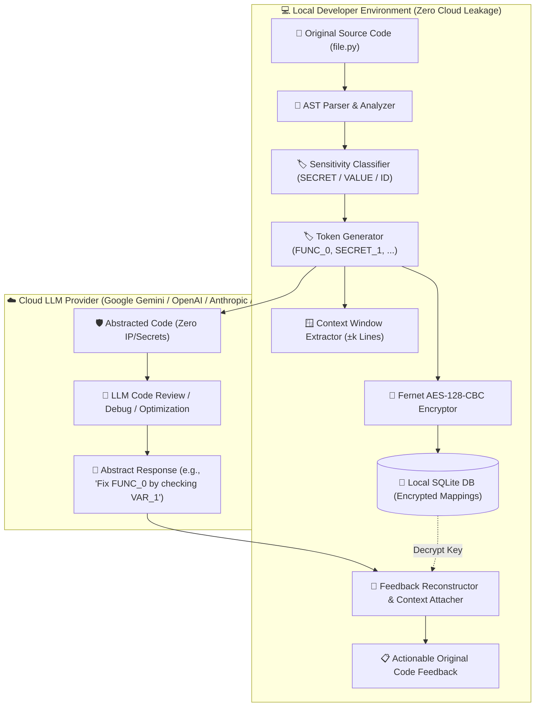

# 🛡️ CodeAbstract

<div align="center">

[](https://www.python.org/)
[](https://opensource.org/licenses/MIT)
[](https://typer.tiangolo.com/)
[](https://cryptography.io/)
[]()
[](https://docs.pytest.org/)

**Privacy-Preserving CLI Framework for Secure LLM Code Consultation**

*Safely consult cloud LLMs (Google Gemini, OpenAI GPT, Anthropic Claude) on sensitive, proprietary code without leaking intellectual property, API keys, credentials, or business logic.*

[Key Features](#-key-features) •
[Architecture](#-system-architecture) •
[How It Works](#-the-4-core-algorithms) •
[Quick Start](#-quick-start) •
[CLI Usage](#-cli-command-reference) •
[Privacy Levels](#-privacy-hierarchy) •
[Evaluation](#-empirical-evaluation--benchmarks) •
[Security Model](#-security--threat-model)

</div>

---

## 📖 Overview

Modern software development relies heavily on Large Language Models (LLMs) for code reviews, bug remediation, security auditing, and performance optimization. However, pasting proprietary codebase snippets into commercial LLM endpoints creates **severe intellectual property (IP) and privacy exposure risks**, including leaks of:

- 🔑 **API keys, secrets, and auth tokens**
- 💼 **Proprietary business algorithms, formulas, and pricing models**
- 🌐 **Internal endpoints, routing topologies, and hostnames**
- 👤 **Customer identifiers and database schema variables**

**CodeAbstract** eliminates this privacy-utility tradeoff. It transforms Python source code into a privacy-optimized intermediate representation via **client-side Abstract Syntax Tree (AST) semantic abstraction**. All mapping states are locally encrypted with AES-128-CBC + HMAC-SHA256 (Fernet) in SQLite. When the LLM responds, CodeAbstract seamlessly reconstructs the suggestions back into the developer's original code context with precise line coordinates.

---

## 🌟 Key Features

- 🌳 **AST-Based Semantic Abstraction**: Parses Python into an AST, replacing identifiers, function names, and sensitive literals with type-tagged tokens (`FUNC_0`, `VAR_1`, `SECRET_0`, `VALUE_0`) while preserving 100% of executable syntax and control flow.
- 🎯 **Sensitivity Classification**: Regex and heuristic classification engines tag AST nodes across `SECRET`, `VALUE`, and `IDENTIFIER` categories.
- 🎚️ **4-Tier Privacy Hierarchy**: Configurable privacy levels (`low`, `medium`, `high`, `critical`) tailored for different compliance requirements.
- 🔐 **Encrypted Local Storage**: Zero cloud leakage of mappings. All bidirectional maps are encrypted using Fernet (AES-128-CBC + HMAC-SHA256) and saved in a local SQLite database.
- 🔄 **Context-Aware Reconstruction**: Automatically maps LLM feedback tokens back to your original source names and attaches multi-line context windows ($\pm k$ lines) for effortless manual application.
- 🤖 **End-to-End Automated Review**: Built-in LLM integration (Google Gemini) that abstracts, queries the model with task-specific system prompts (`review`, `debug`, `optimize`, `security`, `explain`), and reconstructs the response in one command.
- 🧙 **Interactive Terminal Wizard**: Rich, terminal-native UI built with Typer, Rich, Pygments, and Questionary with seamless clipboard copy/paste support.
- 📊 **5-Pillar Evaluation Suite**: Built-in benchmarking suite measuring Privacy Information Ratio (PIR), Reconstruction Fidelity, F1 Classification Accuracy, AST Isomorphism, and Performance.

---

## 🏗️ System Architecture



---

## ⚙️ The 4 Core Algorithms

CodeAbstract implements four formal algorithms designed for privacy-preserving code analysis:

### 1. `ABSTRACT(S, k)` — Semantic Code Abstraction
- Parses Python source $S$ into an Abstract Syntax Tree using standard AST grammar.
- Traverses the AST in topological order, generating deterministic, non-reversible tokens for function names, classes, arguments, variables, secrets, and business values.
- Extracts a context window of $\pm k$ lines around every modified node to preserve situational context for later feedback reconstruction.
- Generates valid, executable abstracted Python code.

### 2. `CLASSIFY(E)` — AST Node Sensitivity Classification
- Evaluates identifier names, string literals, and numeric constants against high-entropy regex patterns and heuristic dictionaries.
- Categorizes each element $E$ into:
  - **`SECRET`**: High-entropy keys, passwords, API tokens (`sk_live_*`, `bearer_*`, `ghp_*`, `AKIA*`, etc.).
  - **`VALUE`**: Business-sensitive constants (pricing algorithms, commission rates, discount formulas, internal URLs).
  - **`IDENTIFIER`**: Generic functions, classes, arguments, and local variables.

### 3. `RECONSTRUCT(R, M̃, K)` — Context-Aware Feedback Reconstruction
- Retrieves the encrypted mapping $\tilde{M}$ using the session key $K$.
- Scans the LLM response $R$ for abstracted token patterns using boundary-safe regex.
- Substitutes tokens with original identifier names.
- Appends an annotated **Source Context Block** showing exact line numbers and code snippets where changes must be applied.

### 4. `ENCRYPT(M) / DECRYPT(M̃, K)` — Cryptographic Storage at Rest
- Generates a unique symmetric cryptographic key per session using Fernet (AES-128 in CBC mode with PKCS7 padding and HMAC-SHA256 authentication).
- Serializes and encrypts the mapping dictionary $M$ before writing to local SQLite (`~/.codeabstract/codeabstract.db`).

---

## 🔍 Visual Demonstration: Before & After

### 1. Original Sensitive Code (`demo_payment.py`)
```python
STRIPE_API_KEY = "sk_live_abc123def456ghi789"
commission_rate = 0.029
base_url = "https://api.payment.com/v2"

def calculate_commission(amount):
    fee = amount * commission_rate
    return round(fee, 2)
```

### 2. Abstracted Code Sent to LLM (Zero Secrets or IP)
```python
SECRET_0 = "SECRET_VALUE_0"
VALUE_0 = "VALUE_0"
VALUE_1 = "VALUE_1"

def FUNC_0(VAR_0):
    VAR_1 = VAR_0 * VALUE_0
    return round(VAR_1, 2)
```

### 3. LLM Response
> *"In `FUNC_0`, ensure `VAR_0` is a positive number before multiplying with `VALUE_0` to prevent negative fee calculation."*

### 4. Reconstructed Output Delivered to Developer
> *"In `calculate_commission`, ensure `amount` is a positive number before multiplying with `commission_rate` to prevent negative fee calculation."*
>
> **Source Context:**
> ```python
> # Lines 6-9: demo_payment.py
> def calculate_commission(amount):
>     fee = amount * commission_rate
>     return round(fee, 2)
> ```

---

## 🚀 Quick Start

### Prerequisites
- Python 3.9 or higher
- Git

### 1. Clone & Install
```powershell
# Clone the repository
git clone https://github.com/yourusername/codeabstract.git
cd codeabstract

# Create & activate a virtual environment
python -m venv .venv

# On Windows (PowerShell):
.\.venv\Scripts\activate
# On Linux / macOS:
source .venv/bin/activate

# Install in editable mode with development dependencies
pip install -e ".[dev]"
```

### 2. Optional: Install LLM Provider Extras
```powershell
# Install Google Gemini support
pip install -e ".[gemini]"

# Or install all supported LLM packages (Gemini, OpenAI, Anthropic)
pip install -e ".[llm]"
```

---

## 🔑 API Key Configuration

For automated reviews (`codeabstract review`), configure your Google Gemini API key using any of the following methods (listed in order of resolution priority):

| Priority | Method | Example |
|:---:|---|---|
| **1** | **CLI Option** | `codeabstract review file.py --api-key YOUR_API_KEY` |
| **2** | **Environment Variable** | `$env:GEMINI_API_KEY="YOUR_API_KEY"` *(PowerShell)*<br>`export GEMINI_API_KEY="YOUR_API_KEY"` *(Bash/Zsh)* |
| **3** | **`.env` File** | Add `GEMINI_API_KEY=YOUR_API_KEY` in the project root directory |
| **4** | **Global App Config** | `codeabstract config set gemini_api_key YOUR_API_KEY` |

---

## 💻 CLI Command Reference

You can execute commands via `codeabstract <command>` or `python cli.py <command>`.

### 🧙 1. Interactive Guided Wizard (Recommended for Beginners)
Launches a visual step-by-step terminal wizard to select files, configure privacy settings, abstract code, copy safely to clipboard, and translate responses.

```powershell
codeabstract interactive
```

---

### 🛡️ 2. Abstract Code (`abstract`)
Transforms proprietary Python code into safe abstracted tokens.

```powershell
# Basic abstraction (outputs to terminal)
codeabstract abstract demo_payment.py

# Abstract with high privacy, copy directly to clipboard, and display mapping stats
codeabstract abstract demo_payment.py --privacy high --copy --show-mapping

# Save abstracted code to an output file
codeabstract abstract demo_payment.py -o abstracted_code.py -k 5
```

**Options:**
- `-p, --privacy`: Privacy level (`low`, `medium`, `high`, `critical`) [default: `high`]
- `-k, --context-window`: Number of surrounding context lines to index [default: `3`]
- `-o, --output`: Save abstract code to a file path
- `-c, --copy`: Copy abstracted code directly to the system clipboard
- `-m, --show-mapping`: Display token mapping statistics table in terminal

---

### 🤖 3. Automated Code Review (`review`)
Performs the full pipeline: abstracts code, queries Google Gemini with specialized prompts, and automatically reconstructs the response.

```powershell
# Run a general code review
codeabstract review demo_payment.py

# Run a dedicated security audit
codeabstract review demo_payment.py --task security

# Run performance optimization review and view the intermediate abstract code
codeabstract review demo_payment.py --task optimize --show-abstract

# Save the final reconstructed review to a file
codeabstract review demo_payment.py --task debug -o review_results.md
```

**Supported Tasks (`--task` / `-t`):**
- `review`: Comprehensive code quality, correctness, and architecture review (default).
- `debug`: Pinpoint edge cases, logical bugs, and unhandled runtime exceptions.
- `optimize`: Suggest algorithmic complexity, memory, and performance optimizations.
- `security`: Inspect for injection vulnerabilities, insecure logic, and sanitization flaws.
- `explain`: Provide clear step-by-step architectural and logic explanations.

---

### 🔄 4. Translate Response (`translate`)
Translates an abstracted LLM response back to original identifiers using a stored session ID.

```powershell
# Translate inline text response
codeabstract translate a1b2c3d4 "Refactor FUNC_0 by modifying VAR_1."

# Translate response from a saved text file and export as Markdown
codeabstract translate a1b2c3d4 --file response.txt --format markdown -o translated.md
```

**Options:**
- `-f, --file`: Read raw LLM response from file
- `-o, --output`: Save translated output to file
- `--format`: Output formatting (`text`, `markdown`, `html`) [default: `text`]

---

### 📊 5. Evaluation Suite (`evaluate`)
Runs the rigorous 5-pillar scientific benchmark suite to validate privacy leakage, reconstruction accuracy, syntax validity, and throughput.

```powershell
# Run the full evaluation suite
codeabstract evaluate

# Evaluate with custom privacy level and custom output folder
codeabstract evaluate --privacy-level medium --output my_benchmarks/

# Quick run (skip latency benchmarks)
codeabstract evaluate --skip-performance
```

---

### 🗄️ 6. Session Management (`sessions`)
Manage and inspect encrypted session mappings stored in your local SQLite database.

```powershell
# List recent abstraction sessions
codeabstract sessions list --limit 10

# Inspect details and token mappings for a specific session
codeabstract sessions show <SESSION_ID>

# Export session metadata and mappings to a JSON file
codeabstract sessions export <SESSION_ID> --output session_backup.json

# Delete a session
codeabstract sessions delete <SESSION_ID> --force
```

---

### ⚙️ 7. Configuration & Stats (`config`, `stats`)
Inspect global application configuration and view usage statistics.

```powershell
# Show active configuration
codeabstract config show

# Set configuration parameters
codeabstract config set gemini_api_key "AIzaSy..."
codeabstract config set default_privacy "high"

# View total abstraction counts, sessions, and database metrics
codeabstract stats
```

---

## 🔒 Privacy Hierarchy

CodeAbstract provides four granular abstraction levels to balance privacy protection against contextual model comprehension:

| Privacy Level | Target Scope | Anonymized Entities | Preserved Entities | Recommended Use Case |
|:---:|---|---|---|---|
| **`low`** | Secrets Only | High-entropy strings, passwords, API tokens, bearer keys | Variable names, function names, class names, constants | Open-source code with accidental hardcoded secrets |
| **`medium`** | Secrets + Business Values | API keys, passwords, pricing constants, commission rates, endpoints | Method signatures, generic loop variables, class names | Commercial apps where algorithm architecture is open |
| **`high`** *(Default)* | Comprehensive IP & Secrets | All multi-char variable names, methods, classes, secrets, business values | Single-char variables (`i`, `x`), language built-ins (`len`, `range`) | Proprietary enterprise codebases, closed-source algorithms |
| **`critical`** | Maximum Anonymization | Absolutely all identifiers, arguments, single-char variables, secrets, literals | Only Python keywords and standard operators | Highly confidential IP, classified financial algorithms |

---

## 🔬 Empirical Evaluation & Benchmarks

CodeAbstract is evaluated across **5 fundamental pillars** using a diverse corpus of 10 real-world Python modules (APIs, ML pipelines, e-commerce pricing, authentication, database ORMs, microservices):

```
================================================================================
                           CODEABSTRACT BENCHMARKS
================================================================================
  Pillar 1: Privacy Information Ratio (PIR)     0.0024        (Target: ≤ 0.05)   ✅
  Pillar 2: Token Hit Rate (Reconstruction)     100.0%        (Target: ≥ 95%)    ✅
  Pillar 3: Classification Macro-F1             0.8937        (Target: ≥ 0.85)   ✅
  Pillar 4: AST Isomorphism Score               1.0000        (Target: = 1.00)   ✅
  Pillar 4: Syntax Validity Rate                100.0%        (Target: = 100%)   ✅
================================================================================
```

### Pillar Definitions:
1. **Privacy Information Ratio (PIR)**: Ratio of residual identifiable proprietary tokens in abstracted output. Score of `0.0024` indicates >99.7% of proprietary tokens are fully concealed.
2. **Reconstruction Fidelity**: Percentage of abstracted tokens in LLM responses successfully mapped back to the original source (`100.0%`).
3. **Classification Macro-F1**: Precision/Recall harmonic mean for categorizing `SECRET` (0.97 F1), `VALUE` (0.86 F1), and `IDENTIFIER` (0.85 F1) nodes.
4. **Code Structure Preservation (CSP)**: Validates that abstracted code is valid Python (`100%`) with an exact 1:1 AST isomorphism score (`1.0000`), ensuring LLMs comprehend the true structural logic.
5. **Performance & Scalability**: Sub-millisecond abstraction throughput per module.

---

## 🔒 Security & Threat Model

```
                    ┌──────────────────────────────────────────────┐
                    │               TRUST BOUNDARY                 │
                    │                                              │
  Local Machine     │  1. AST Parsing & Regex Classification       │
 (Client-Controlled)│  2. Token Generation & Replacement           │
                    │  3. Fernet AES-128-CBC Mapping Encryption   │
                    │  4. Local SQLite Database Storage            │
                    └──────────────────────┬───────────────────────┘
                                           │ Abstract Code Only
                                           │ (No Secrets / Identifiers)
                                           ▼
                    ┌──────────────────────────────────────────────┐
  Untrusted Public  │  5. External LLM Consultation                │
  Cloud Boundary    │     (Google Gemini / OpenAI / Anthropic)     │
                    └──────────────────────────────────────────────┘
```

- **Zero Cloud Exposure of Mappings**: Bidirectional mapping tables are never sent to external servers or LLM providers.
- **Cryptographic Isolation**: All session mapping tables are encrypted using Fernet (128-bit AES in CBC mode with HMAC-SHA256 for integrity authentication).
- **Transient Keys**: Encryption keys can be configured per session or tied to the local user profile.
- **Local SQLite Storage**: Encrypted databases are stored strictly in the user's home directory (`~/.codeabstract/codeabstract.db`) with standard OS file permissions.

---

## 📂 Project Structure

```
codeabstract/
├── algorithms/                 # Formal Core Algorithm Implementations
│   ├── abstract.py             # Algorithm 1: ABSTRACT(S, k) - AST transformation
│   ├── classify.py             # Algorithm 2: CLASSIFY(E) - Sensitivity classifier
│   ├── reconstruct.py          # Algorithm 3: RECONSTRUCT(R, M, K) - Response translator
│   ├── encrypt.py              # Algorithm 4: ENCRYPT(M) / DECRYPT(M, K) - Cryptography
│   └── helpers.py              # AST traversal and tree transformation utilities
├── commands/                   # Typer CLI Command Implementations
│   ├── abstract_cmd.py         # 'abstract' command handler
│   ├── review_cmd.py           # 'review' automated LLM review handler
│   ├── translate_cmd.py        # 'translate' response handler
│   ├── interactive_cmd.py      # 'interactive' guided wizard
│   ├── sessions_cmd.py         # 'sessions' management handler
│   ├── config_cmd.py           # 'config' setting handler
│   └── stats_cmd.py            # 'stats' dashboard handler
├── core/                       # Core Abstraction Engines
│   ├── ast_parser.py           # AST generation and node locator
│   ├── context_extractor.py    # Multi-line ±k code window extractor
│   ├── pattern_matcher.py      # Regex engines for high-entropy secret detection
│   └── token_generator.py      # Deterministic token synthesis
├── evaluation/                 # Scientific Evaluation & Benchmark Suite
│   ├── benchmarks/             # 10 benchmark python files and labeled dataset
│   ├── metrics/                # Metric pillars (PIR, RF, F1, Structure, Performance)
│   ├── report.py               # Markdown and JSON report generator
│   └── run_eval.py             # Standalone evaluation runner
├── llm/                        # LLM Provider Integrations
│   └── gemini_client.py        # Google Gemini API connector with system prompts
├── storage/                    # Encrypted Persistence Layer
│   ├── database.py             # SQLite connection and migration schema
│   ├── mapping_store.py        # Encrypted CRUD operations for token maps
│   └── session_manager.py      # Session lifecycle, query, and pruning manager
├── ui/                         # Rich Terminal User Interface
│   ├── banner.py               # ASCII banners and application branding
│   ├── diff_view.py            # Syntax-highlighted side-by-side diff viewer
│   ├── formatters.py           # Terminal tables, callouts, and alert panels
│   └── prompts.py              # Interactive Questionary user prompts
├── utils/                      # Utilities & Configuration
│   ├── config.py               # Settings loader (.env, env vars, config file)
│   ├── crypto.py               # Fernet key generation & encryption routines
│   └── logger.py               # Structured logging
├── tests/                      # Pytest Test Suite
│   ├── test_algorithms.py      # Unit tests for core algorithms
│   ├── test_cli.py             # CLI command execution tests
│   ├── test_crypto.py          # Cryptography and cipher validation
│   └── test_evaluation.py      # Evaluation suite regression tests
├── cli.py                      # Primary CLI Entry Point
├── demo_payment.py             # Sample file for demonstration and testing
├── pyproject.toml              # Build system, dependencies, and packaging metadata
└── README.md                   # Project Documentation
```

---

## 🧪 Testing

CodeAbstract includes a full test suite verifying algorithms, AST safety, encryption round-trips, and CLI workflows:

```powershell
# Run the entire test suite
pytest

# Run tests with verbose output
pytest tests/ -v

# Run tests with code coverage analysis
pytest tests/ --cov=. --cov-report=term-missing
```

---

## 📦 Dependencies

| Package | Version | Purpose |
|---|---|---|
| **[typer](https://typer.tiangolo.com/)** | `>=0.12.3` | Modern, intuitive CLI framework |
| **[rich](https://rich.readthedocs.io/)** | `>=13.7.1` | Rich terminal formatting, tables, syntax highlighting, and progress bars |
| **[cryptography](https://cryptography.io/)** | `>=42.0.5` | Fernet AES-128-CBC + HMAC-SHA256 encryption |
| **[pygments](https://pygments.org/)** | `>=2.17.2` | Source code syntax tokenization |
| **[questionary](https://questionary.readthedocs.io/)** | `>=2.0.1` | Interactive prompts and wizard workflows |
| **[pyperclip](https://github.com/asweigart/pyperclip)** | `>=1.8.2` | Cross-platform clipboard copy/paste integration |
| **[google-generativeai](https://github.com/google-gemini/generative-ai-python)** | `>=0.4.0` | Google Gemini LLM API integration *(optional extra)* |

---

## 📄 License

This project is licensed under the **MIT License** — see the [LICENSE](LICENSE) file for details.
